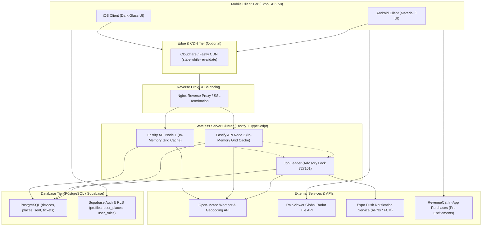
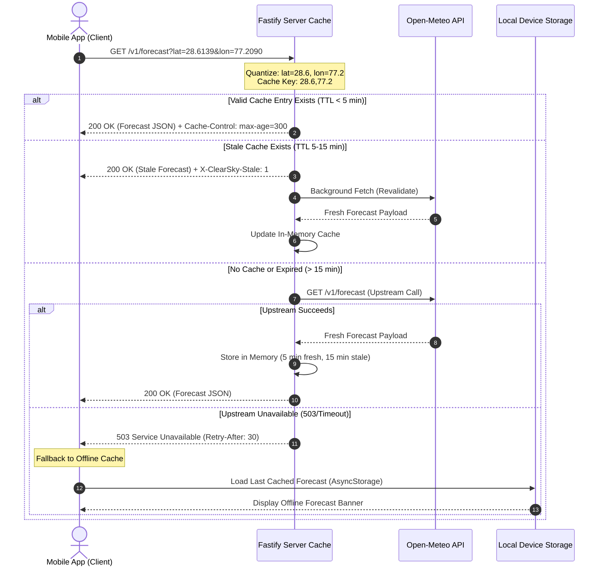
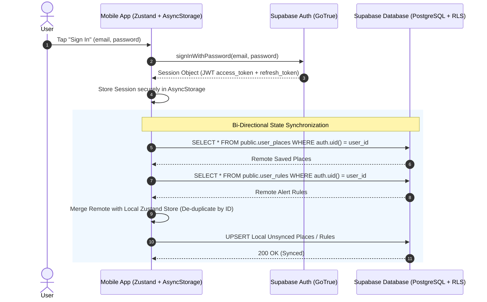
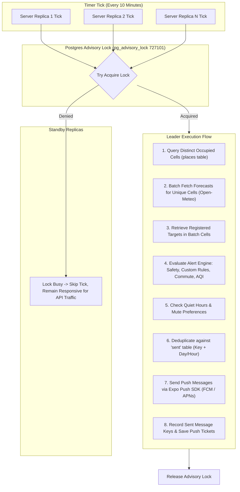

# System Architecture & Technical Design — ClearSky

## 1. System Overview

ClearSky is an ad-free, hyper-local, privacy-centric weather intelligence platform built as a high-performance monorepo. The platform combines a cross-platform mobile application (React Native / Expo SDK 58), a stateless server proxy with cell-quantized in-memory caching (Fastify + Node.js 20), an event-driven background push alert engine, and a managed PostgreSQL database with Row Level Security (Supabase).



---

## 2. Monorepo Structure

```
clearsky-v3/
├── .github/
│   └── workflows/
│       ├── ci.yml                 # Lint, unit tests, TypeScript check, export dry-run
│       ├── deploy-server.yml      # Docker build & container registry deployment
│       └── eas-build.yml          # Automated EAS Cloud build triggers
├── app/                           # Mobile Application (Expo SDK 58)
│   ├── src/
│   │   ├── app/                   # File-based routing (expo-router)
│   │   │   ├── (tabs)/            # Tab navigation (today, hourly, radar, places, alerts, settings)
│   │   │   ├── auth.tsx           # Supabase Email/Password login & signup
│   │   │   ├── rules.tsx          # Custom alert rules editor (Pro)
│   │   │   ├── pro.tsx            # RevenueCat subscription paywall
│   │   │   └── _layout.tsx        # Root layout, theme provider, Expo Observe & Sentry init
│   │   ├── components/            # Platform-adaptive UI components (Glass vs. Material 3)
│   │   ├── lib/                   # Client-side API, push tokens, Supabase sync, storage
│   │   └── shared/                # Code shared with backend (types, grid math, alert rules)
│   ├── app.json                   # Expo application config & native permissions
│   └── eas.json                   # Expo Application Services build profiles
├── server/                        # Backend API & Alert Worker (Fastify + TypeScript)
│   ├── src/
│   │   ├── main.ts                # Fastify server entrypoint & HTTP endpoints
│   │   ├── forecast.ts            # Cell-based caching proxy for weather data
│   │   ├── jobs.ts                # Distributed background workers (alerts, receipts, cleanup)
│   │   ├── db.ts                  # PostgreSQL connection pool & transactional migrations
│   │   ├── supabase.ts            # Supabase server context & JWT verification
│   │   └── config.ts              # Strongly-typed environment configuration
│   ├── Dockerfile                 # Multi-stage production container build
│   └── docker-compose.yml         # Local & staging orchestration with Nginx & Postgres
├── supabase/
│   └── schema.sql                 # Cloud database schema, triggers & RLS policies
└── docs/                          # Engineering & operational documentation
    ├── PRD.md
    ├── ARCHITECTURE.md
    ├── SECURITY.md
    ├── DATABASE_SCHEMA.md
    └── DEPLOYMENT_DEVOPS.md
```

---

## 3. End-to-End Weather Data Flow & Cell Quantization

To protect user location privacy and eliminate redundant weather provider requests, ClearSky groups geographic coordinates into **quantized spatial grid cells** ($\sim 11\text{ km} \times 11\text{ km}$):

$$\text{grid\_lat} = \text{round}(\text{lat} \times 10) / 10, \quad \text{grid\_lon} = \text{round}(\text{lon} \times 10) / 10$$

### Weather Request Sequence



---

## 4. Supabase Cloud Authentication & Cross-Device Sync

ClearSky supports hybrid offline-first operation. Unauthenticated users store saved places and settings locally in Zustand (`AsyncStorage`). When a user signs in, their local data seamlessly syncs with the cloud.



---

## 5. Background Alert Worker Architecture & Distributed Locking

The Fastify server cluster runs continuous background jobs without requiring a separate message broker like Celery or BullMQ. Instead, it leverages **PostgreSQL Advisory Locks** to ensure only one node in the cluster acts as the active job leader per tick.



### Advisory Lock IDs
* `727001`: Database Schema Migration lock (prevents race conditions during multi-container startup).
* `727101`: Alert Processing Leader lock (runs every 10 minutes).
* `727102`: Push Receipt Reconciliation lock (polls Expo ticket status every 15 minutes).
* `727103`: Database Housekeeping lock (prunes old records nightly).

---

## 6. High Availability & Fault Tolerance Principles

1. **Zero Downtime Deploys:** Replicas handle HTTP requests independently. Database migrations execute inside transactional migrations guarded by advisory lock `727001`.
2. **Provider Circuit Breaking:** If Open-Meteo returns errors or times out, the server serves stale cached data for up to 3 hours, tagging the response header `X-ClearSky-Stale: 1`.
3. **Graceful Push Handling:** If an Expo push token returns `DeviceNotRegistered`, the worker removes the stale token from the database immediately, keeping the active target index lean.
