# Database Schema & Data Models — ClearSky

## 1. Overview

ClearSky's data architecture is split into two complementary PostgreSQL database layers:
1. **User Identity & Cloud Sync Layer (Supabase):** Stores user profiles, multi-device saved places, and custom weather alert rules, protected by PostgreSQL Row Level Security (RLS).
2. **Alert Engine & Push Pipeline Layer (Fastify Backend DB):** High-throughput tables optimized for spatial grid indexing, push token registration, alert deduplication, and ticket receipt tracking.

---

## 2. Entity-Relationship Diagram (ERD)

```mermaid
erDiagram
    %% Supabase User Identity Domain
    AUTH_USERS ||--o| PROFILES : "has"
    AUTH_USERS ||--o{ USER_PLACES : "saves"
    AUTH_USERS ||--o{ USER_RULES : "configures"
    AUTH_USERS ||--o{ DEVICE_TOKENS : "registers"

    PROFILES {
        uuid id PK "references auth.users(id)"
        text email "user email address"
        text lang "language code (en, hi)"
        boolean is_pro "subscription entitlement status"
        text temp_unit "C or F"
        text wind_unit "kmh, mph, or ms"
        timestamptz created_at "creation timestamp"
        timestamptz updated_at "last profile update"
    }

    USER_PLACES {
        text id PK "place identifier (lat,lon or uuid)"
        uuid user_id PK "references auth.users(id)"
        text name "city or location label"
        text sub "state, country or subtitle"
        double_precision lat "latitude"
        double_precision lon "longitude"
        timestamptz created_at "saved timestamp"
    }

    USER_RULES {
        text id PK "rule identifier"
        uuid user_id PK "references auth.users(id)"
        text kind "rain, heat, cold, wind, uv"
        double_precision threshold "trigger cutoff value"
        boolean enabled "active switch"
        timestamptz created_at "configured timestamp"
    }

    DEVICE_TOKENS {
        text token PK "Expo push token"
        uuid user_id FK "references auth.users(id)"
        text platform "ios or android"
        timestamptz created_at "token timestamp"
    }

    %% Fastify Alert Worker Domain
    DEVICES ||--o{ PLACES : "tracks"
    DEVICES ||--o{ SENT : "receives"
    DEVICES ||--o{ TICKETS : "verifies"

    DEVICES {
        text token PK "Expo push token"
        text platform "ios or android"
        text tz "IANA timezone"
        text lang "en or hi"
        jsonb prefs "user notification preferences"
        bigint muted_until "quiet epoch timestamp"
        bigint updated_at "last heartbeat epoch ms"
    }

    PLACES {
        text token PK "references devices(token)"
        text cell PK "quantized grid (lat,lon)"
        double_precision lat "original latitude"
        double_precision lon "original longitude"
        text name "location display name"
    }

    SENT {
        text token PK "references devices(token)"
        text key PK "alert deduplication key"
        bigint at "sent epoch timestamp"
    }

    TICKETS {
        text id PK "Expo push ticket receipt id"
        text token "device push token"
        bigint at "creation epoch timestamp"
    }

    SCHEMA_MIGRATIONS {
        int id PK "migration version id"
        bigint at "applied timestamp"
    }
```



---

## 3. Data Dictionaries & Table Definitions

### 3.1 Supabase Cloud Tables (User Management & Sync)

#### `public.profiles`
| Column | Type | Constraints | Description |
|---|---|---|---|
| `id` | `uuid` | `PRIMARY KEY`, `REFERENCES auth.users(id) ON DELETE CASCADE` | Matches Supabase Auth user UUID. |
| `email` | `text` | Nullable | User's primary email address. |
| `lang` | `text` | `NOT NULL`, `DEFAULT 'en'` | User interface language (`en` or `hi`). |
| `is_pro` | `boolean` | `NOT NULL`, `DEFAULT false` | Pro subscription entitlement. |
| `temp_unit` | `text` | `NOT NULL`, `DEFAULT 'C'` | Temperature unit preference (`C` or `F`). |
| `wind_unit` | `text` | `NOT NULL`, `DEFAULT 'kmh'` | Wind unit preference (`kmh`, `mph`, `ms`). |
| `created_at`| `timestamptz` | `NOT NULL`, `DEFAULT now()` | Row creation timestamp. |
| `updated_at`| `timestamptz` | `NOT NULL`, `DEFAULT now()` | Auto-updated on record change. |

#### `public.user_places`
| Column | Type | Constraints | Description |
|---|---|---|---|
| `id` | `text` | `NOT NULL` | Place identifier (e.g. `28.61,77.21`). |
| `user_id` | `uuid` | `NOT NULL`, `REFERENCES auth.users(id) ON DELETE CASCADE` | Owning user. |
| `name` | `text` | `NOT NULL` | Location name (e.g., "New Delhi"). |
| `sub` | `text` | Nullable | Subtitle (e.g., "Delhi, India"). |
| `lat` | `double precision` | `NOT NULL` | Latitude coordinate. |
| `lon` | `double precision` | `NOT NULL` | Longitude coordinate. |
| `created_at`| `timestamptz` | `NOT NULL`, `DEFAULT now()` | Timestamp added. |
*Composite Primary Key:* `(user_id, id)`.

#### `public.user_rules`
| Column | Type | Constraints | Description |
|---|---|---|---|
| `id` | `text` | `NOT NULL` | Rule identifier (UUID or slug). |
| `user_id` | `uuid` | `NOT NULL`, `REFERENCES auth.users(id) ON DELETE CASCADE` | Owning user. |
| `kind` | `text` | `NOT NULL` | Condition type: `rain`, `heat`, `cold`, `wind`, `uv`. |
| `threshold`| `double precision` | `NOT NULL` | Metric trigger threshold. |
| `enabled` | `boolean` | `NOT NULL`, `DEFAULT true` | Rule activation switch. |
| `created_at`| `timestamptz` | `NOT NULL`, `DEFAULT now()` | Rule creation timestamp. |
*Composite Primary Key:* `(user_id, id)`.

---

### 3.2 Backend Alert Pipeline Tables (Fastify PostgreSQL)

#### `devices`
Stores active devices registered for background weather alert push notifications.
* `token` (`TEXT PRIMARY KEY`): The Expo push token (`ExponentPushToken[...]`).
* `platform` (`TEXT NOT NULL`): `ios` or `android`.
* `tz` (`TEXT NOT NULL`): Device IANA timezone (e.g., `Asia/Kolkata`, `America/New_York`).
* `lang` (`TEXT NOT NULL DEFAULT 'en'`): Language for alert notifications (`en` or `hi`).
* `prefs` (`JSONB NOT NULL`): Notification configuration (quiet hours, severe alerts, rainSoon, custom rules, commute settings).
* `muted_until` (`BIGINT NOT NULL DEFAULT 0`): Epoch millisecond timestamp until which notifications are suppressed.
* `updated_at` (`BIGINT NOT NULL`): Heartbeat timestamp of last device update.

#### `places`
Maps push tokens to quantized $\sim 11\text{ km}$ spatial cells.
* `token` (`TEXT NOT NULL REFERENCES devices(token) ON DELETE CASCADE`)
* `cell` (`TEXT NOT NULL`): Quantized coordinates, e.g. `28.6,77.2`.
* `lat` (`DOUBLE PRECISION NOT NULL`)
* `lon` (`DOUBLE PRECISION NOT NULL`)
* `name` (`TEXT NOT NULL`)
* *Primary Key:* `(token, cell)`
* *Index:* `CREATE INDEX places_cell ON places(cell);` (Enables instant lookup of all devices monitoring a specific weather grid cell).

#### `sent`
Alert deduplication log preventing spam.
* `token` (`TEXT NOT NULL`)
* `key` (`TEXT NOT NULL`): Composed of alert type, cell, and time window (e.g. `rain_soon:28.6,77.2:2026-11-22:15`).
* `at` (`BIGINT NOT NULL`): Epoch timestamp sent.
* *Primary Key:* `(token, key)`
* *Index:* `CREATE INDEX sent_at ON sent(at);`

#### `tickets`
Temporary tracking table for Expo push notification delivery receipts.
* `id` (`TEXT PRIMARY KEY`): Expo receipt ID.
* `token` (`TEXT NOT NULL`): Push token associated with receipt.
* `at` (`BIGINT NOT NULL`): Timestamp when message was submitted to Expo.
* *Index:* `CREATE INDEX tickets_at ON tickets(at);`

---

## 4. Distributed Concurrency & PostgreSQL Advisory Locks

To guarantee distributed high availability without race conditions, ClearSky utilizes **PostgreSQL Advisory Locks** across all worker instances:

```sql
-- Schema Migration Lock (Acquired on container startup)
SELECT pg_advisory_lock(727001);
-- ... run migrations ...
SELECT pg_advisory_unlock(727001);

-- Alert Worker Leader Election (Runs every 10 minutes)
SELECT pg_try_advisory_lock(727101);

-- Receipt Processing Worker Lock (Runs every 15 minutes)
SELECT pg_try_advisory_lock(727102);

-- Housekeeping & Pruning Lock (Runs daily at midnight)
SELECT pg_try_advisory_lock(727103);
```

### Advantages of Advisory Locks:
* Zero additional infrastructure (no Redis or ZooKeeper required).
* Automatically released if the holding database connection terminates unexpectedly.
* Negligible overhead on PostgreSQL performance.

---

## 5. Data Lifecycle & Pruning Policies

To keep database tables lean and ensure predictable sub-millisecond query performance:

| Table | Retention Period | Pruning Strategy |
|---|---|---|
| `sent` | 48 Hours | Deleted automatically during nightly housekeeping (`DELETE FROM sent WHERE at < now() - 48h`). |
| `tickets` | 24 Hours | Checked for Expo delivery errors; purged once receipt status is confirmed or older than 24h. |
| `devices` | 90 Days | Devices that have not sent a heartbeat update in 90 days are pruned via cascade delete. |
| `places` | Cascade | Automatically purged immediately upon parent device deletion (`ON DELETE CASCADE`). |
