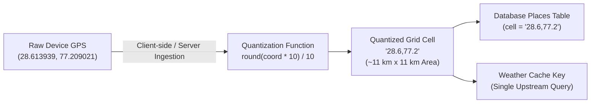
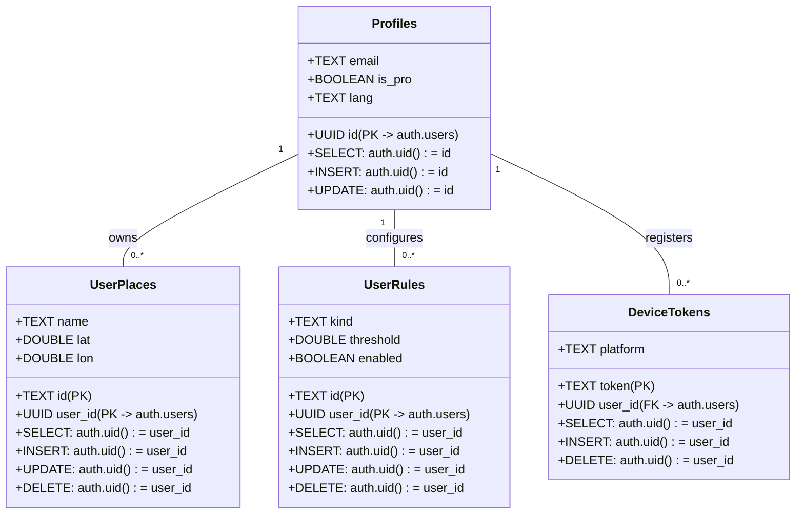

# Security & Privacy Architecture — ClearSky

## 1. Security Philosophy & Principles

ClearSky is engineered with a **Privacy-First, Defense-in-Depth** security philosophy. The platform strictly adheres to the following principles:
* **Zero Advertising & Tracking SDKs:** No third-party ad networks, tracking pixels, or telemetry beacons are bundled in the application.
* **Location Minimization & Anonymity:** Precise GPS coordinates are never retained in server logs or database persistence layers.
* **Least Privilege Access:** All database interactions are gated by strict PostgreSQL Row Level Security (RLS) policies and read/write scoped database roles.
* **Cryptographic Token Integrity:** All authenticated API requests require verifiable asymmetric JWT signatures issued by Supabase GoTrue.

---

## 2. Threat Modeling & Attack Surface Analysis (STRIDE)

| Threat Category | Potential Attack Vector | ClearSky Mitigation & Countermeasure |
|---|---|---|
| **Spoofing** | Adversary attempts to impersonate another user to access or alter their saved places and alert rules. | **Supabase Auth JWT:** Verified cryptographically using public keys (JWKS). RLS policies strictly bind rows to `auth.uid()`. |
| **Tampering** | Man-in-the-Middle (MitM) attacker intercepts or tampers with weather forecasts or push tokens. | **Strict TLS 1.3 Transport:** Fastify enforces Helmet security headers (HSTS, CSP). All external API calls (Open-Meteo, Expo) use HTTPS. |
| **Repudiation** | Malicious actor denies modifying alert rules or sending spam push notifications. | **Immutable Audit Records:** PostgreSQL migrations record execution timestamps; server logs structured JSON with unique correlation IDs (`req.id`). |
| **Information Disclosure** | Leakage of user home/work locations through database breach or network snooping. | **Spatial Grid Quantization:** Lat/Lon coordinates are mapped to $\sim 11\text{ km}$ cells before server storage. Push tokens are decoupled from user emails. |
| **Denial of Service (DoS)** | Attacker floods `/v1/forecast` or `/v1/devices` endpoints to exhaust upstream quotas or server CPU. | **Tiered Rate Limiting & Edge Caching:** Fastify rate-limiter throttles requests per IP and per push token; in-memory cache shields upstream APIs. |
| **Elevation of Privilege** | Free tier user attempts to unlock Pro features (custom rules, commute alerts) without paying. | **Defense-in-Depth Gating:** Client-side paywall UI gates options, while server rule payload validation limits array size and requires valid signatures. |

---

## 3. Location Privacy: Spatial Grid Quantization

Traditional weather applications transmit and store high-precision GPS coordinates (e.g., `28.613939, 77.209021`), which pinpoints a user's exact doorstep or desk. ClearSky implements mathematical coordinate truncation:



### Privacy Benefits:
1. **Zero Location Tracking:** The server cannot reconstruct individual user movements or identify sensitive locations (homes, hospitals, places of worship).
2. **K-Anonymity:** Thousands of users residing within the same $11\text{ km}$ geographic block share the exact same cached forecast and database cell identifier.
3. **Bandwidth & Compute Efficiency:** Upstream weather providers are queried once per grid cell rather than once per user.

---

## 4. Supabase Row Level Security (RLS) Enforcement

ClearSky uses Supabase PostgreSQL Row Level Security to guarantee multi-tenant data isolation. Database tables (`profiles`, `user_places`, `user_rules`, `device_tokens`) enforce policies directly at the SQL engine level. Even if client-side logic is bypassed, unauthorized database reads or writes are rejected by PostgreSQL.

### RLS Policy Matrix



### SQL Verification Example
```sql
-- Verify that a user cannot access another user's saved places:
SET ROLE authenticated;
SET request.jwt.claims TO '{"sub": "11111111-1111-1111-1111-111111111111"}';

-- This query returns ONLY rows matching the simulated user's UID:
SELECT * FROM public.user_places;
```

---

## 5. Rate Limiting & Mobile Carrier CGNAT Mitigation

Mobile networks commonly place tens of thousands of mobile subscribers behind shared Carrier-Grade NAT (CGNAT) gateway IP addresses. Applying aggressive per-IP rate limits would unintentionally block legitimate users.

ClearSky solves this with **Context-Aware Rate Limiting**:

1. **Read Endpoints (`/v1/forecast`, `/v1/air`):**
   * High per-IP limit (e.g., 300 req/min).
   * Cached at memory and HTTP layer (`Cache-Control: public, max-age=300`).
   * Read requests do not hit the database.
2. **Device Registration (`/v1/devices`):**
   * Throttled **per Push Token** (`max: 20 per minute per token`).
   * An attacker attempting to flood device registrations from a single IP cannot poison records for arbitrary push tokens.
   * Input validation rejects invalid Expo push token formats (`Expo.isExpoPushToken(token)`).
3. **Geocoding Proxy (`/v1/geocode`):**
   * Throttled at 40 req/min with a 1-hour in-memory cache to prevent abuse of upstream search quotas.

---

## 6. Secret Hygiene & Environment Variable Separation

ClearSky enforces strict separation between public configuration and server secrets:

| Variable | Scope | Handling & Security Rule |
|---|---|---|
| `EXPO_PUBLIC_API_URL` | Client (Public) | Embedded in app bundle. Contains no secrets. |
| `EXPO_PUBLIC_SUPABASE_URL` | Client (Public) | Safe for public distribution. |
| `EXPO_PUBLIC_SUPABASE_ANON_KEY` | Client (Public) | Limited public key governed by PostgreSQL RLS. |
| `DATABASE_URL` | Server (Private) | Injected via container secrets / environment. Never checked into git. |
| `SUPABASE_SERVICE_ROLE_KEY` | Server (Private) | Bypasses RLS. Stored exclusively on trusted backend servers for administrative tasks. |
| `EXPO_ACCESS_TOKEN` | Server / CI | Required for sending push notifications via Expo push service. Managed in EAS Secrets. |
| `METRICS_TOKEN` | Server (Private) | Bearer token securing `/metrics` endpoint against unauthorized scraping. |

### CI Security Checks
* **Gitleaks Scanning:** CI automatically scans commit diffs for leaked API keys, tokens, and private keys.
* **Strict `.gitignore`:** All `.env`, `.env.local`, `.pem`, and credentials files are prevented from entering version control.
